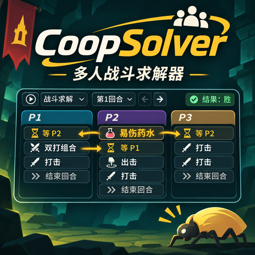
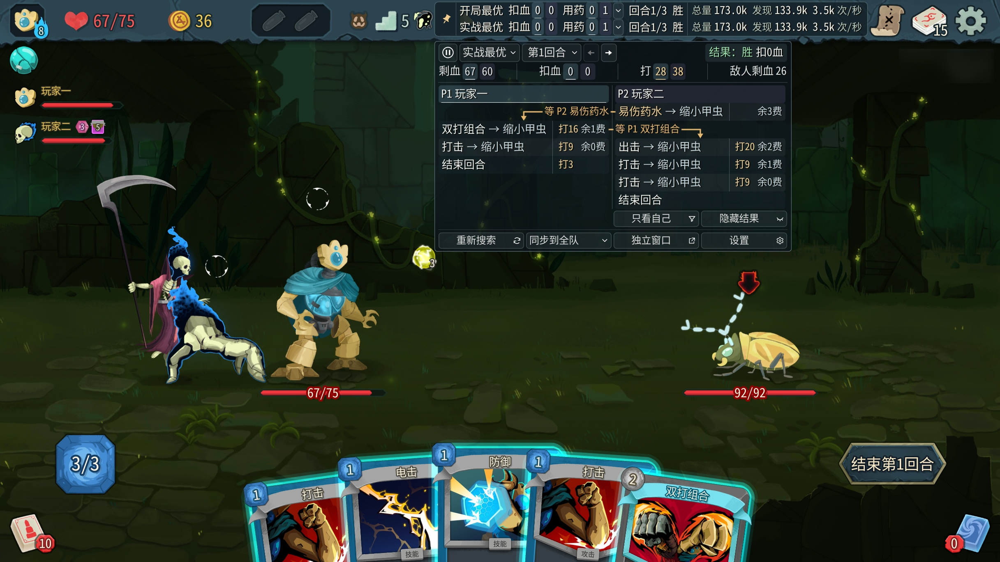
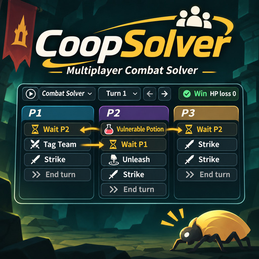
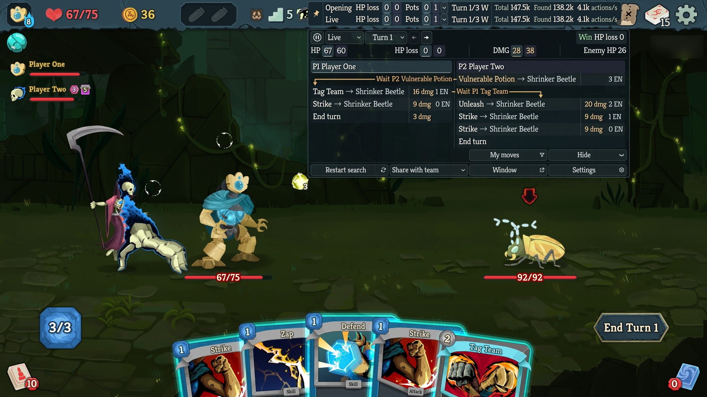

# CoopSolver

[中文](#中文) | [English](#english)

## 中文

**《杀戮尖塔 2》多人战斗求解器，支持单人模式。**

通过后台模拟战斗、搜索路线，实时展示当前找到的最优战斗路线，包含出牌顺序、攻击目标、选牌操作、药水方案及预计战损。多人联机时，房主可将路线同步给队友。

### 功能特性

#### 多人协同求解

考虑全队玩家的手牌、能量、遗物、药水，以及它们之间的相互作用。

求解结果按玩家分列展示，并标明各玩家之间的行动依赖关系：

- 互不影响的操作可以各自按顺序执行。
- 需要等待队友的操作会通过箭头与对应的队友行动连接。
- 支持［只看自己］，排除来自其他队友的无关项。

例如，某张攻击牌需要在队友施加易伤后打出，界面会通过箭头标明需要等待的操作。

#### 战斗路线可视化

按回合展示完整的战斗路线，单人模式采用列表布局，多人模式采用分栏布局。

- 显示出牌顺序、目标、伤害、剩余能量、选牌及用药等信息。
- 显示预计战损及战损变化图表。
- 支持查看和切换不同的候选路线。
- 根据实战操作更新求解结果。

#### 其他功能

- **自动打牌**：单人模式下可以自动执行当前战斗路线，包括出牌、选牌及使用药水，可随时恢复手动操作。
- **独立窗口**：可以将求解面板以独立窗口显示。
- **联机同步**：房主可以将求解结果实时同步给队友，队友也可以脱离主机独立搜索。

### 搜索算法

采用独立设计的启发式搜索算法，通过局面评估函数对搜索过程中产生的战斗局面进行评分，优先探索更有潜力的战斗路线。局面评估函数中引入了通过机器学习实时优化的权重参数，以改善求解质量。

由于行动的理论组合数量庞大，并不一定始终能找到最优解，路线质量会受搜索时间与评估权重等影响。

### 联机兼容性

**未安装本 Mod 的玩家均可以正常参与战斗。**

- 房主安装后，可以将求解结果同步给已安装本 Mod 的队友。
- 房主未安装时，队友仍可独立求解。

### 下载与安装

当前支持的游戏版本：**0.111.x / 0.114.x**

1. 从 [Releases](https://github.com/SiyeW/sts2-coop-solver/releases/latest) 下载最新版本的 CoopSolver。
2. 下载前置 Mod [RitsuLib 0.6.16](https://github.com/BAKAOLC/STS2-RitsuLib/releases/download/v0.6.16/STS2-RitsuLib.0.6.16.variant-pack.zip)。
3. 在 Steam 库中右键点击《杀戮尖塔 2》，选择［管理］→［浏览本地文件］，打开游戏安装目录。
4. 将两个 Mod 分别解压至游戏安装目录下的 `mods/` 文件夹中。
5. 启动游戏，在模组列表中启用 CoopSolver 和 RitsuLib。

安装完成后，请确认以下文件位于对应目录中：

- `mods/CoopSolver/CoopSolver.json`
- `mods/STS2-RitsuLib/mod_manifest.json`

### 使用方法

进入战斗后，将鼠标悬停在界面顶部的 CoopSolver 信息栏上，展开求解面板，点击左上角的 ▶ 开始搜索。可以使用滚轮缩放界面大小。

#### 单人模式

可以按照求解结果手动操作，也可以开启［自动打牌］执行当前路线。通过［用药］旁的下拉菜单可以查看其他已搜索到的方案。

#### 多人模式

房主开始搜索后，开启［同步到全队］，队友选择［跟随主机］即可查看同一条战斗路线。

各玩家按照自己所在列的行动顺序操作，遇到等待提示时，待队友完成箭头所指向的操作后再继续。

### 更新与反馈

- [版本更新记录](CHANGELOG.md)
- [问题反馈与功能建议](https://github.com/SiyeW/sts2-coop-solver/issues)

### 致谢

本项目使用经修改的战斗模拟内核，源自 [Co-op Bots](https://github.com/imbalilang/STS2-Co-op_Bots) 和 [CombatSolver](https://github.com/Torch1230/CombatSolver)。

感谢 CombatSolver、Co-op Bots、Random Foreseer 和 [RitsuLib](https://github.com/BAKAOLC/STS2-RitsuLib) 等开源项目及其开发者。

### 开源许可

本项目原创代码采用 [Apache License 2.0](LICENSE) 开源，第三方组件遵循各自的开源许可，详见 [THIRD_PARTY_NOTICES.md](THIRD_PARTY_NOTICES.md)。

---

## English

**A multiplayer combat solver for Slay the Spire 2, with single-player support.**

CoopSolver runs combat simulations and searches in the background, displaying the best combat plan found so far in real time, including card play order, targets, card selections, potion usage, and predicted HP loss. In multiplayer, the host can synchronize combat plans with teammates.

### Features

#### Cooperative Combat Solving

The solver takes into account every player's hand, energy, relics, and potions, as well as the interactions between them.

Combat plans are displayed in separate player columns, with dependencies between players' actions marked:

- Independent actions can be performed in each player's own sequence.
- Actions that require waiting for a teammate are connected to the corresponding teammate action by arrows.
- The **Only Show My Actions** option hides unrelated actions from other players.

For example, if an attack needs to be played after a teammate applies Vulnerable, an arrow indicates which action to wait for.

#### Combat Plan Visualization

Complete combat plans are displayed turn by turn, in a list for single-player combat and in separate columns for multiplayer combat.

- View card play order, targets, damage, remaining energy, card selections, and potion usage.
- View predicted HP loss and HP loss charts.
- Browse and switch between alternative combat plans.
- Combat plans update based on actual player actions.

#### Additional Features

- **Auto Play**: Automatically execute the current combat plan in single-player mode, including playing cards, making card selections, and using potions. Resume manual control at any time.
- **Separate Window**: Display the solver panel in a separate window.
- **Multiplayer Synchronization**: The host can share combat plans with teammates in real time. Teammates can also run independent local searches.

### Search Algorithm

CoopSolver uses an independently developed heuristic search algorithm. A state evaluation function scores combat states encountered during the search, prioritizing more promising combat plans. The evaluation function incorporates weights that are optimized in real time through machine learning to improve solution quality.

Given the enormous number of possible action combinations, the solver may not always find the optimal solution. The quality of combat plans depends on factors such as search time and evaluation weights.

### Multiplayer Compatibility

**Players without the mod installed can participate in combat as usual.**

- If the host has CoopSolver installed, combat plans can be shared with teammates who also have the mod.
- If the host does not have CoopSolver installed, other players can still run independent searches.

### Download & Installation

Currently supported game versions: **0.111.x / 0.114.x**

1. Download the latest version of CoopSolver from [Releases](https://github.com/SiyeW/sts2-coop-solver/releases/latest).
2. Download the required dependency, [RitsuLib 0.6.16](https://github.com/BAKAOLC/STS2-RitsuLib/releases/download/v0.6.16/STS2-RitsuLib.0.6.16.variant-pack.zip).
3. Right-click Slay the Spire 2 in your Steam library and select **Manage → Browse local files** to open the game installation directory.
4. Extract both mods into the `mods/` directory inside the game installation folder.
5. Launch the game and enable both CoopSolver and RitsuLib in the mod list.

After installation, make sure the following files are in their respective locations:

- `mods/CoopSolver/CoopSolver.json`
- `mods/STS2-RitsuLib/mod_manifest.json`

### Usage

During combat, hover over the CoopSolver status bar at the top of the screen to expand the solver panel, then click the ▶ button in the upper-left corner to start searching. Use the mouse wheel to adjust the interface scale.

#### Single-player

Follow the combat plan manually or enable **Auto Play** to execute it automatically. Use the dropdown next to the potion usage option to browse alternative combat plans found by the solver.

#### Multiplayer

Once the host starts searching, enable **Sync to Party**. Teammates can select **Follow Host** to view the same combat plan.

Follow the action sequence in your own column. When a waiting indicator appears, wait for your teammate to complete the action indicated by the arrow before proceeding.

### Updates & Feedback

- [Changelog](CHANGELOG.md)
- [Bug Reports & Feature Requests](https://github.com/SiyeW/sts2-coop-solver/issues)

### Acknowledgements

This project uses a modified combat simulation core derived from [Co-op Bots](https://github.com/imbalilang/STS2-Co-op_Bots) and [CombatSolver](https://github.com/Torch1230/CombatSolver).

Thanks to the developers of CombatSolver, Co-op Bots, Random Foreseer, [RitsuLib](https://github.com/BAKAOLC/STS2-RitsuLib), and other open-source projects.

### License

Original code in this project is licensed under the [Apache License 2.0](LICENSE). Third-party components are subject to their respective licenses. See [THIRD_PARTY_NOTICES.md](THIRD_PARTY_NOTICES.md) for details.
